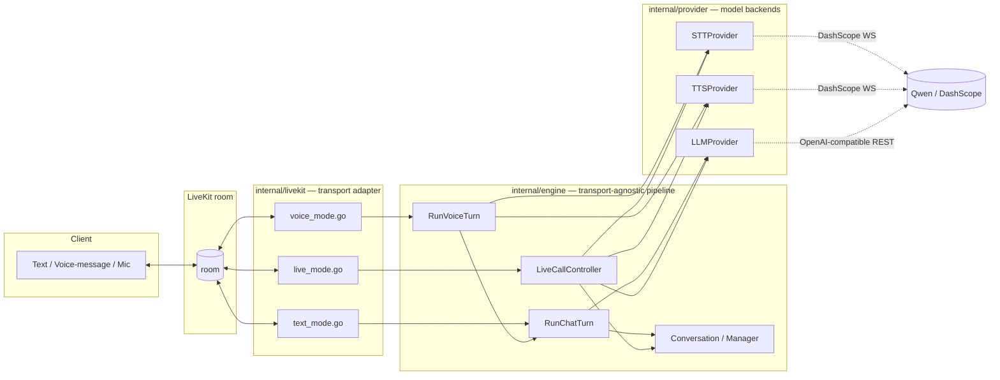
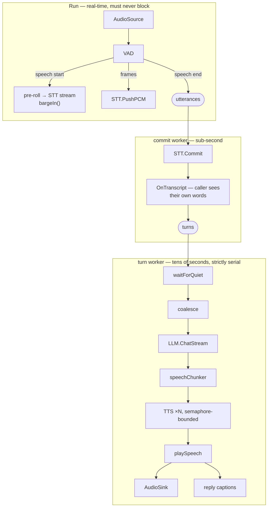

# Design

System ownership, future auth/business projects, and review findings are in
[the workspace architecture](../../docs/ARCHITECTURE.md).

## 1. Overview

This is a small, real, runnable voice agent built around the STT→LLM→TTS
pattern on top of [LiveKit](https://livekit.io). It supports three ways of
talking to it — pure text, an uploaded voice message, and a live realtime
call — over a single LiveKit room per conversation.

It's a deliberately simplified sibling of a much larger Python project
(`livekit-agent`, a sales-CRM voice assistant): that project's business logic
(CRM tools, sales playbooks, memory, collaboration workflows) is dropped
entirely here. What's kept is the generic, reusable shape underneath it —
provider-agnostic STT/LLM/TTS, a turn/conversation model, and a VAD-driven
live-call loop with barge-in — reimplemented from scratch in Go, small enough
to read end to end in one sitting.

## 2. Architecture



Primary runtime packages:

- **`internal/provider`** — capability interfaces (`STTProvider`,
  `LLMProvider`, `TTSProvider`) plus a name→factory registry. Concrete
  backends live in subpackages (`qwen/`, `openaicompat/`) and self-register
  via `init()`, the same shape as Go's `database/sql` driver pattern.
- **`internal/engine`** — the pipeline itself: per-participant conversation
  history, a one-shot chat turn runner (`RunChatTurn`), a batch voice-message runner
  (`RunVoiceTurn`), and the live-call
  turn loop (`LiveCallController`). **Zero imports of LiveKit, WebRTC, or
  Opus** — it uses provider interfaces, pure-Go audio utilities, telemetry, and its own ports
  (`ReplySink`, `AudioSource`, `AudioSink`, in `ports.go`).
- **`internal/livekit`** — the server adapter that imports the LiveKit SDK,
  pion/webrtc, or the Opus codec. It joins a room, turns LiveKit's
  text-streams/byte-streams/tracks into calls into `engine`, and implements
  `engine`'s ports so the engine never has to know a room exists.

The SDK-free `internal/roomprotocol` defines topics and stream attributes.
Both this adapter and `cmd/testclient` consume it; the test harness no longer
imports the server adapter. `internal/roomauth` owns local development token
minting. Workspace checks compare the separate client's room contract constants.

For voice messages, the adapter decodes/downmixes/resamples WAV input and calls
`engine.RunVoiceTurn` with 16kHz mono PCM16. The engine transcribes, publishes the
transcript through `VoiceReplySink`, streams the chat reply, and synthesizes PCM.
The adapter encodes and sends the returned audio. No LiveKit types enter the engine.

## 3. Three extensibility axes

This split gives the project three independent places to extend, matching the
things a real deployment would actually want to swap:

**Model providers** — swap Qwen for something else by implementing one of
the three interfaces in `internal/provider` and registering it:

```go
provider.RegisterTTS("elevenlabs", func(cfg config.Config) (provider.TTSProvider, error) {
    return elevenlabs.New(cfg.ElevenLabsAPIKey), nil
})
```

then flip `TTS_PROVIDER=elevenlabs` in `.env`. No other code changes. The
LLM side is even simpler in practice: `internal/provider/openaicompat`
already works against *any* OpenAI-compatible endpoint, so switching from
Qwen (via DashScope's compatible-mode endpoint) to real OpenAI, Doubao, or
DeepSeek is a three-line `.env` change (`OPENAI_BASE_URL`/`OPENAI_API_KEY`/
`OPENAI_MODEL`), not a code change at all.

**Transport** — swap LiveKit for something else (a raw WebSocket server, a
Twilio Media Stream, a different WebRTC SFU) by implementing three small
interfaces:

```go
type ReplySink interface   { WriteToken(delta string); Close() }
type AudioSource interface { SampleRate() int; ReadFrame() ([]int16, error) }
type AudioSink interface {
    SampleRate() int
    PushPCM(samples []int16)
    Drain()
    QueuedDuration() time.Duration // pushed, not yet played
}
```

`internal/engine` never changes. This is what actually gets tested for real
in `internal/engine/live_turn_test.go`: a fake `AudioSource`/`AudioSink` and
fake providers drive the entire VAD→STT→LLM→TTS→barge-in state machine with
no network, no LiveKit server, and no cgo — something that wasn't possible
before this split, when the turn loop talked to `*webrtc.TrackRemote` and an
Opus encoder directly.

**Voice Activity Detection (VAD)** — swap the default energy-based detector
(`internal/audio/vad.go`) for a neural model (Silero, WebRTC VAD) or a fake
for testing by implementing `engine.VADProcessor` (`internal/engine/ports.go`):

```go
type VADProcessor interface {
    Process(frame []int16, sampleRate int) audio.Event
    Speaking() bool
    SetMinSpeechMS(ms int)
}
```

and passing it via `engine.LiveConfig.VADOverride`.

## 4. The three modes

All three run over **one LiveKit room per conversation** — the room *is*
the session, regardless of which modality a given message uses. A single
per-identity `engine.Conversation` (`internal/engine/conversation.go`) is
shared across all three, so a user can type a question, then follow up with
a voice message, and the agent still has full context.

| Mode | Client → agent | Agent → client |
|---|---|---|
| **Text** | LiveKit text-stream, topic `agent.chat` or official `lk.chat` | streamed text-stream reply, same topic |
| **Voice message** | LiveKit byte-stream (WAV), topic `agent.voice` | transcript via text-stream (`agent.transcript` / `lk.transcription`), then WAV byte-stream reply on `agent.voice` |
| **Live call** | a published audio track (jitter-buffered via `samplebuilder`) | audio track back, *plus* transcript (`agent.transcript` and `lk.transcription`), streamed reply text (`agent.chat` / `lk.chat`), streaming state (`agent.state`), and persistent participant attribute `lk.agent.state` |

Live-call mode needs no explicit "start call" signal: `internal/livekit/agent.go`
arms it via `RoomCallback.OnTrackSubscribed` — any subscribed audio track
starts a `LiveCallController` for that participant.

[`TEXT-VOICE-UX.md`](TEXT-VOICE-UX.md) covers the experience text and
voice-message mode are built to produce; [`LIVE-CALL-UX.md`](LIVE-CALL-UX.md)
(and §6 below) cover the live-call case.

Live-call mode publishes on every channel a client can listen on, via
optional nil-safe hooks on `LiveCallController` — a transport that sets none
of them just gets the audio track:

- `OnTranscript` fires once per **utterance** with the final STT transcript,
  as soon as it exists, independently of whatever reply it leads to
  (`internal/livekit/live_mode.go` sends it on `agent.transcript`, and also
  on the official `lk.transcription` topic with `lk.segment_id`, `lk.transcription_final="true"`,
  and `lk.transcribed_track_id`).
- `NewInterimSink` fires at speech-start, carrying the recognizer's
  best-guess-so-far word by word on `agent.transcript.interim`, so a caller
  sees themselves being heard before they've stopped talking.
- `NewReplySink` fires once per **turn** — note "turn", not "utterance": two
  utterances close enough together are answered by one turn, and an utterance
  that transcribes to nothing produces none. Its text is released at the pace
  of the audio going out, not the pace the model generates it (§6).
- `OnState` reports `listening`/`thinking`/`speaking`/`interrupted`/`idle` on
  `agent.state` and sets the server-retained participant attribute `lk.agent.state`.
  The "interrupted" state and transition to "listening" are load-bearing: they signal
  the client to immediately drop audio already in its speaker buffer.
- `trackAudioSource` reassembles incoming RTP packets through Pion's
  `samplebuilder.SampleBuilder` jitter buffer before decoding Opus frames, ensuring
  packet reordering and jitter on network connections do not corrupt the audio
  stream fed into VAD and STT.

## 5. The DashScope/Qwen realtime wire protocol

There's no official Go SDK for DashScope's Qwen realtime STT/TTS, so
`internal/provider/qwen` speaks the WebSocket protocol directly (reverse-
engineered from the Python `dashscope` SDK's source, since it isn't
publicly documented at this level of detail). Both endpoints are the same
base URL with a different `model` query parameter, and the event shapes
closely mirror OpenAI's Realtime API:

```
wss://dashscope.aliyuncs.com/api-ws/v1/realtime?model=<model>
Header: Authorization: Bearer <DASHSCOPE_API_KEY>
```

**STT** (`qwen3-asr-flash-realtime`) — the agent drives segmentation itself
(VAD or "here's the whole recording"), so `turn_detection` is disabled:

```json
→ {"type":"session.update","session":{"modalities":["text"],
    "input_audio_format":"pcm","sample_rate":16000,
    "turn_detection":null,"input_audio_transcription":{"language":null}}}
← {"type":"session.updated", ...}
→ {"type":"input_audio_buffer.append","audio":"<base64 pcm16>"}   (repeated)
→ {"type":"input_audio_buffer.commit"}
← {"type":"conversation.item.input_audio_transcription.completed","transcript":"..."}
```

(`.text`/`.delta` variants carry interim partial transcripts before
`.completed` arrives.)

**TTS** (`qwen3-tts-flash-realtime`):

```json
→ {"type":"session.update","session":{"voice":"Cherry","mode":"server_commit",
    "response_format":"pcm","sample_rate":24000}}
→ {"type":"input_text_buffer.append","text":"..."}
→ {"type":"input_text_buffer.commit"}
← {"type":"response.audio.delta","delta":"<base64 pcm16>"}        (repeated)
← {"type":"response.done"}
```

The LLM step needs none of this — DashScope's compatible-mode endpoint
(`https://dashscope.aliyuncs.com/compatible-mode/v1`) is plain OpenAI
chat-completions SSE, handled by `internal/provider/openaicompat` with a
compact hand-rolled client (no SDK dependency).

## 6. The live-call turn loop

`internal/engine/live_turn.go`'s `LiveCallController` is the most involved
piece, and the part most shaped by what real calls turned out to do rather
than by what the design expected. This section is the mechanism;
[`LIVE-CALL-UX.md`](LIVE-CALL-UX.md) is the experience it exists to
produce — the five moments of a turn, the measured latency budget, and the
invariants a change here must not break.

### The three stages

The work of a call splits into three things that run at completely different
speeds, and each gets its own goroutine:



Commit and turn used to share one worker, so that turns could not overlap.
That was correct but far too coarse: an utterance's transcript sat
un-committed behind the *previous* reply's entire playback, so on a measured
call someone's own words reached their screen up to 45 seconds after they
said them. Splitting them means the transcript is always ~700ms behind the
speaker no matter how long the agent is talking, and only reply generation
stays serial.

### Turn-taking

An energy VAD ends an utterance after `MinSilenceMS` of quiet, which someone
pausing to think crosses all the time. Real transcripts from a test call look
like `嗯，我今天的计划是。` followed seconds later by the rest of the sentence.
Answering that fragment is wrong twice over — the reply is to half a question,
and it arrives while the caller is still saying the other half. Three things
prevent it:

- **`waitForQuiet`** — a turn does not start while any utterance is open or
  still being transcribed, even though a complete transcript is already
  queued and ready to answer.
- **`coalesce`** — everything waiting when the turn finally starts is put to
  the model as one turn, not answered one reply at a time.
- **`preRoll`** — the ~400ms of audio that convinced VAD speech had started
  is replayed into the STT stream. Without it the recognizer never received
  the first syllable of anything, because the stream was opened only once
  `MinSpeechMS` of speech had already gone past.

### Barge-in

Every reply is tagged with the `turnVersion` in effect when it started. New
speech bumps the version unconditionally, cancels the in-flight turn's
`context.Context`, and calls `sink.Drain()`; anything still holding a stale
version stops touching the sink. Unconditionally matters: an interruption
arriving during the STT commit — before there is any reply to cancel — still
has to invalidate the turn that is about to start.

Three further pieces make an interruption feel like one:

- A **stricter debounce while speaking** (`BargeInMinSpeechMS`): starting a
  fresh turn should be as responsive as possible, but cutting a reply off
  mid-word should take real speech rather than a cough — or, since there is
  no echo cancellation anywhere in this pipeline, the agent's own voice
  coming back through an open speaker.
- **`TopicState`'s `interrupted` message** (`internal/livekit/live_mode.go`),
  the one thing `sink.Drain()` cannot do: audio already on the wire is in the
  *client's* buffers and will keep playing regardless. The message travels
  over the data channel, arriving ahead of the audio it invalidates, so the
  client can drop that buffer too.
- **Recording what was heard, not what was generated.** An interrupted turn
  appends the chunks actually spoken, plus a `[interrupted]` marker, to the
  conversation.
  It used to append nothing at all, so the model had no idea it had been
  talking and would restart the same sentence on the next turn.

### Pacing: chunking, concurrency, and captions

`speechChunker` (`sentence.go`) slices the token stream into what actually
gets synthesized. One TTS call per sentence — the original design — is the
wrong granularity in both directions. Every `Synthesize` is its own provider
WebSocket handshake, about a second of fixed cost whatever the length, and
firing them all at once made them queue against each other at the far end: on
one measured reply, 18 concurrent calls, three-character chunks taking 7.7s,
and one hitting the provider's 20s idle timeout and being lost outright. So
later chunks are batched to `MinChunkRunes`, concurrency is capped by a
semaphore reserved in submission order before starting workers, and each
call has its own timeout. The *first* chunk of a reply ignores the minimum,
because it alone decides how long the caller waits to hear anything.

`playSpeech` then does two things that are easy to mistake for inefficiency:

- It writes the reply's **text** next to the audio rather than from the LLM
  callback. Generation runs far ahead of playback, so captioning at token
  speed put the whole reply on screen while barely a sentence had been
  spoken — and a barge-in then left the caller looking at paragraphs the
  agent never said.
- It **holds each chunk until the sink's backlog drops below `MaxLeadMS`**
  instead of handing it over the moment TTS returns. That keeps captions
  within `MaxLeadMS` of the voice and keeps little enough audio committed
  that a barge-in has almost nothing to throw away. It cannot starve the
  speaker: a chunk goes the moment there is room, and the first one never
  waits.

The frame-level chunking that used to live in the engine (splitting
synthesized PCM into exact 20ms/960-sample Opus frames) lives in
`internal/livekit`'s `trackAudioSink` writer: the engine resamples once per
chunk and calls `sink.PushPCM`, and the adapter owns turning that into
properly-paced RTP packets — and, via `QueuedDuration`, owns being able to
say how much of it is still unplayed. `PushPCM` only queues PCM under a short
mutex; the writer encodes one frame per tick and zero-pads the final partial
frame so the queue can reach empty. Turn admission and enqueue serialize
with barge-in using the controller mutex. State and sink callbacks must
return promptly; no provider I/O or playback wait runs under that mutex.

## 7. Correlation IDs, tracing, and metrics

Text mode, voice-message mode, and live-call mode each spin up their own
goroutine per client-initiated unit of work, all calling into the same
`internal/engine`/`internal/provider` layers concurrently. Without something
tying a given turn's log lines together, interleaved output from two
participants (or two overlapping voice messages from one) is impossible to
follow. `internal/telemetry` fixes that with a correlation ID threaded on
`context.Context`, rather than a field every call site has to remember to
pass:

- `telemetry.StartSession(ctx)` is called exactly once per client-initiated
  **request or session** — the text/voice stream handlers call it per
  message (`internal/livekit/text_mode.go`, `voice_mode.go`), and
  `agent.go`'s `OnTrackSubscribed` calls it once for the whole life of a
  live call. It stamps a random OpenTelemetry trace ID
  (`go.opentelemetry.io/otel/trace`) onto a derived context.
- Every context derived from that one afterwards — `context.WithCancel`,
  `context.WithTimeout`, the per-utterance and per-turn contexts
  `LiveCallController` creates in `live_turn.go` — carries the same ID,
  because OTel's `SpanContext` rides along as an ordinary context value.
  `LiveCallController` holds the call's context as `sessionCtx` for exactly
  this reason: one ID covers every utterance and turn of a call, not just
  its start.
- Log call sites use the `*Context` slog variants (`slog.InfoContext`,
  `slog.ErrorContext`) instead of the plain ones. `cmd/agent/main.go` sets
  the default logger's handler to `telemetry.NewLogHandler(base)`, which
  reads the ID off the context and attaches it as a `correlation_id`
  attribute — so call sites never format it themselves:

  ```
  time=... level=INFO msg="live call: heard" identity=bob text="hello" correlation_id=4bf92f3577b34da6a3ce929d0e0e4736
  ```

Using OTel's trace-ID type instead of a bespoke UUID was deliberate groundwork
for exactly what's wired up now: `telemetry.SetupOTel` (`internal/telemetry/otel.go`)
installs a real `sdktrace.TracerProvider`/`sdkmetric.MeterProvider` exporting
OTLP/gRPC to `docker-compose.yml`'s `otel-lgtm` service (also reachable via
the `otel-collector` alias). Grafana at http://localhost:3002 provides traces,
metrics and logs; the older files in `deploy/` are not used by this Compose stack. Every call site already just passed
`ctx` around, so this was purely additive:

- `StartSession` now also opens a root `"session"` span (closed by its
  returned func) instead of only stamping a bare `SpanContext` — the exact
  same trace ID, now actually exported.
- `telemetry.StartStage(ctx, name, attrs...)` starts a child span for one
  STT/LLM/TTS provider call or one live-call turn and starts a timer; the
  returned `end(err)` records the error (if any) on the span, closes it, and
  records the stage's duration and outcome as the `t10.stage.duration`/
  `t10.stage.calls` metrics, tagged by `stage` and `error` — one call site
  drives both a trace and a metric. See `engine/chat.go`'s `RunChatTurn`,
  `engine/live_turn.go`'s `commitUtterance`/`handleTurn`/`synthesizeChunk`, and
  `engine/voice.go`'s `RunVoiceTurn` for the call sites.
- Both StartSession's span and every StartStage span/metric are no-ops
  until `SetupOTel` is called — gated on `OTEL_EXPORTER_OTLP_ENDPOINT` in
  `cmd/agent/main.go` — so nothing here behaves differently, and
  `CorrelationID` returns the same ID either way, whether or not an OTLP
  endpoint is configured. This was verified empirically (not just assumed
  from the API docs): a fabricated `SpanContext` marked `Remote: true`
  survives being wrapped in a no-op span exactly as it does a real one,
  because `trace.SpanContextFromContext` — what `CorrelationID` and the
  real SDK's own span-parenting both call — checks the remote marker before
  falling back to an ambient `Span` object.
- The client (a separate module — see `../../mac-client/CLAUDE.md`) has its own
  trimmed copy of this same package, exporting to the same collector over
  its published host port. A trace ID logged on one side is *not* the same
  trace as the other's today — the two only share a room, not a trace
  context — so a client-observed round trip and the agent-side spans that
  produced it show up as separate traces in Tempo. Propagating one trace
  context across the LiveKit room (e.g. via a text-stream attribute) would
  unify them; that's future work, not done here.

## 8. Deliberate simplifications vs. the Python original

- **Energy-based VAD** (`internal/audio/vad.go`) instead of a neural
  (Silero) model — an `RMS ≥ threshold` state machine with speech/silence
  debounce. Good enough to drive turn-taking in a demo, and decoupled behind
  the `engine.VADProcessor` interface (`internal/engine/ports.go`) so a neural
  model (or a test fake) can be plugged in via `LiveConfig.VADOverride`.
- **No tool-calling loop.** `LLMProvider.ChatStream` is a plain streaming
  chat call. The Python original's `LLMAgentLoop` (function/tool dispatch,
  background tools, etc.) has no equivalent here — there's nothing to call
  tools *for* in a generic agent, and adding one wouldn't need `engine`'s
  other pieces to change.
- **A fresh WebSocket per utterance/turn** for both STT and TTS
  (`internal/provider/qwen`), instead of the Python original's pooled,
  reused connection. Simpler, at the cost of one extra handshake per turn —
  a natural place to optimize later if latency matters more than clarity.
- **Voice-message replies are a WAV byte-stream**, not a published track —
  there's no live audio session to attach one to unless a call is already
  in progress.
- **The live-call test client is file-driven**, not a real mic/speaker: it
  publishes a WAV as the simulated microphone and records the agent's reply
  track to a WAV file. Fully scriptable, no OS audio permissions, and (via
  `-interrupt-file`/`-interrupt-after`) it can stage a second utterance
  mid-reply to exercise barge-in deterministically.

## 9. Running it

`docker-compose.yml` brings up a local LiveKit dev server and the agent
together — the LiveKit devkey/secret in `keys`/`LIVEKIT_KEYS` are wired to
`.env`'s `LIVEKIT_API_KEY`/`LIVEKIT_API_SECRET` via Compose's own `.env`
variable substitution, so both stay in sync automatically:

```bash
cp .env.example .env   # fill in DASHSCOPE_API_KEY, OPENAI_*; LiveKit keys already match docker-compose.yml

docker compose up --build

# in another terminal (testclient always runs on the host, against the
# LiveKit server's published ports):
go run ./cmd/testclient text  -msg "hello"
go run ./cmd/testclient voice -file sample.wav -out reply.wav
go run ./cmd/testclient live  -file sample.wav -out reply.wav \
    -interrupt-file interrupt.wav -interrupt-after 10
```

Each command above is a separate request/session (see §7): watch
`docker compose logs -f agent` while running one and every log line for it
shares one `correlation_id`, e.g.:

```bash
docker compose logs -f agent | grep <correlation_id printed for that run>
```

The agent container's `LIVEKIT_URL` is overridden to `ws://livekit-server:7880`
(the compose network's internal address, on the t10-net network) — the
`.env` value (`ws://localhost:8880`) is what host-run processes like
`cmd/testclient` use. LiveKit's ports are published on the host as
8880/8881/8882 (→ container 7880/7881/7882) rather than the conventional
7880-7882, so this stack doesn't collide with another LiveKit dev server
already running on the same machine.

To iterate on the agent itself without a container rebuild per change, run
just the LiveKit server via Compose and the agent on the host:

```bash
docker compose up livekit-server
go run ./cmd/agent -room demo   # separate terminal; needs libopus (below)
```

Building the agent binary directly on the host requires `libopus` and
`libopusfile` (for the Opus cgo binding) plus `pkg-config`
(`brew install opus opusfile pkgconf` on macOS); everything else is pure
Go. The Docker build installs the Debian equivalents itself
(`libopus-dev`/`libopusfile-dev`), so no host toolchain is needed for the
`docker compose up --build` path.

## 10. Extending it

**Add a new STT/LLM/TTS provider**: implement the relevant interface in
`internal/provider/{stt,llm,tts}.go`, register it via `provider.RegisterXxx`
in an `init()` in a new subpackage, blank-import that subpackage from
`cmd/agent/main.go`, and point the matching `*_PROVIDER` env var at its
registered name.

**Add a new transport**: implement `engine.ReplySink` for text replies and
`engine.AudioSource`/`engine.AudioSink` for live audio, wire them up the way
`internal/livekit` does (join/accept a session, translate its native
messages into `engine.RunChatTurn`/`engine.LiveCallController.Run` calls),
and `internal/engine` needs no changes at all.

## Live caption wire details

Live text streams carry an `event_order` attribute, monotonically increasing
within one call. The client uses it instead of millisecond timestamps to
reject delayed state changes. Interim and final transcripts also carry an
`utterance_id` identifying the captured speech segment; an older final can
then arrive without erasing a newer segment's interim caption.

`agent.transcript.interim` streams marked `format=snapshot-jsonl` contain
newline-delimited JSON objects such as `{"text":"当前识别结果"}`. Each object
replaces the prior hypothesis. Qwen sends a confirmed `text` prefix plus a
correctable `stash` suffix, so treating updates as append-only deltas either
hides the preview or duplicates it. `agent.transcript` remains plain text
and is authoritative. Reply streams remain plain append-only text.


## Text and voice-message completion contract

See [TEXT-VOICE-UX.md](TEXT-VOICE-UX.md#current-behavior-september-13-2026) for
current behavior and checks. `agent.message.status` is a per-request JSONL stream,
separate from live-call `agent.state`. Status, transcript, text and audio carry
`request_id`; voice WAV streams also carry zero-based `chunk_index`. A final
`done` status includes `audio_chunks`; clients wait for all advertised data,
since handlers for different streams may run out of order. `error` terminates
the exchange immediately. Agent and interactive client must be upgraded together.
Text and voice turns share a FIFO admission queue per identity and a 50-second
server deadline; voice synthesis consumes sentence chunks during LLM generation.
